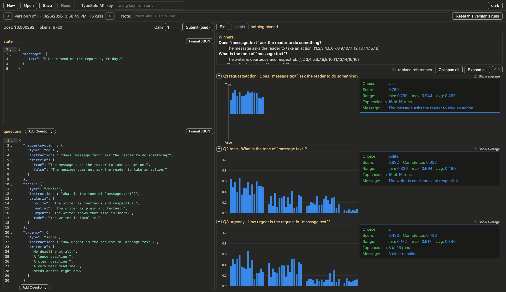

# TypeSafe playground

A local web page for trying TypeSafe questions.



## Run it

```
cd playground
bun install
bun run start
```

The server prints its address. Open that address in a browser.

### Options

- `--port <number>`: use this port. The number must be from 1 to 65535. Without `--port`, the server picks a free port.
- `--lan`: also serve the page on your local network. The server prints one more address for each network address of the computer. Other devices on the same network can open the page at those addresses. They can also press Submit, and those runs use your API key.

Example: `bun playground.ts --port 4318 --lan`

## API key

Submit sends paid requests to TypeSafe, so it needs a TypeSafe API key. The server gets the key from one of two places:

1. The **TypeSafe API key** box at the top of the page. A key in this box is used first. The page sends it to the local server with each Submit. The server does not write it to disk.
2. `TYPESAFE_API_KEY` in `playground/.env`. Bun reads this file when the server starts. When this key is set, the box shows "Using key from .env".

Without a key, the Submit button is disabled. `.env` is in `playground/.gitignore`.

## Data on disk

- `playground/results/playground-history.json` holds every version: its state, its questions, the output of each run, and its note. The server makes this file when it first starts. It writes the file again after each Submit, New, Open, note change, and **Reset this version's runs**. `results/` is in `playground/.gitignore`.
- **Save** writes the same versions to a JSON file that you choose. The default name is `playground-versions.json`.
- **Open** reads a file like that and replaces the history file with it.
- **New** replaces the history file with one blank version.
- Before New or Open, the page asks you to save if you have unsaved changes.
- Save and Open use the browser's file picker. It works only in Chromium browsers, such as Chrome and Edge.
- The browser's local storage keeps your light or dark theme choice.

## Versions

A version is one state and one set of questions, plus all the runs made with them. Use versions to compare how a change to the state or the questions changes the answers.

- `<` and `>` show the previous and the next version. The left and right arrow keys do the same when you are not typing in a box or an editor. After the last version, `>` goes back to the first one.
- The arrows are disabled when there is only one version.
- The label shows the version number, the time of the version, and the number of calls.
- When you edit the state or the questions, the label shows the next version number and "not run yet". Submit makes that new version.
- When you press Submit with no edits, the new runs go into the version that the page shows.

## Placeholders in the questions editor

**Add Question** opens a menu with three question types: Noul, Score, and Choice. Choose one to add a new question to the questions editor.

- The new question has placeholder values for its name, its instructions, and its criteria.
- Placeholders show in grey. The selected placeholder has a highlight.
- Press Tab to select the next placeholder, and Shift+Tab to select the previous one. Type to replace the selected text.
- When you change a placeholder, it becomes regular text, and Tab skips it.

## Backtick key names

In the state editor or the questions editor, type a backtick (`` ` ``). A list shows the key names from both editors.

- Use the arrow keys to select a name, then press Tab or Enter. The editor adds the name and a closing backtick.
- After a key name and a dot, for example `` `message. ``, the list shows only the keys inside that object.
- Use this to write references such as `` `message.text` `` in question instructions.
