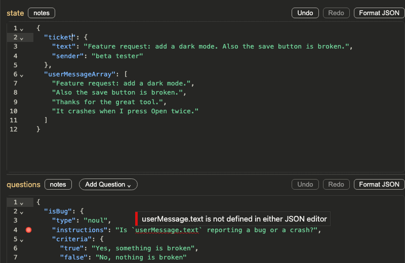
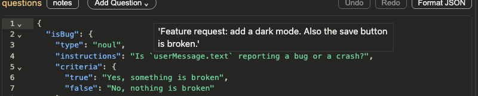
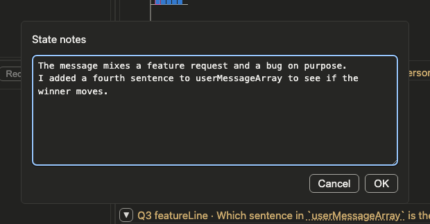
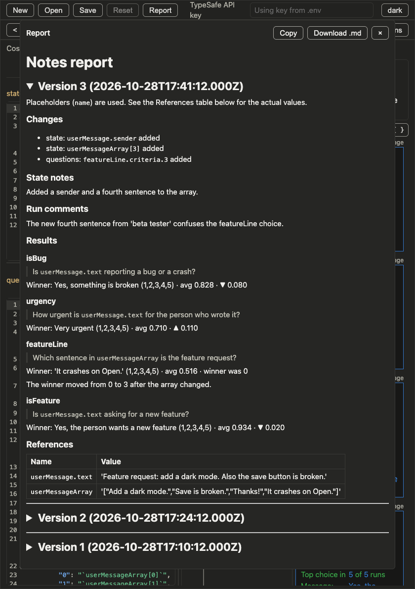

# TypeSafe playground

A local web page for trying TypeSafe questions.


## Run it

```
cd playground
bun install
bun run start
```

The server prints its address. Open that address in a browser.

### Options

- `--port <number>`: use this port. The number must be from 1 to 65535. Without `--port`, the server picks a free port.
- `--lan`: also serve the page on your local network. The server prints one more address for each network address of the computer. Other devices on the same network can open the page at those addresses. They can also press Submit, and those runs use your API key.

Example: `bun playground.ts --port 4318 --lan`

## API key

Submit sends paid requests to TypeSafe, so it needs a TypeSafe API key. The server gets the key from one of two places:

1. The **TypeSafe API key** box at the top of the page. A key in this box is used first. The page sends it to the local server with each Submit. The server does not write it to disk.
2. `TYPESAFE_API_KEY` in `playground/.env`. Bun reads this file when the server starts. When this key is set, the box shows "Using key from .env".

Without a key, the Submit button is disabled. `.env` is in `playground/.gitignore`.

## Data on disk

- `playground/results/playground-history.json` holds every version: its state, its questions, the output of each run, and its notes. The server makes this file when it first starts. It writes the file again after each Submit, New, Open, note change, and **Reset this version's runs**. `results/` is in `playground/.gitignore`.
- **Save** writes the same versions to a JSON file that you choose. The default name is `playground-versions.json`.
- **Open** reads a file like that and replaces the history file with it.
- **New** replaces the history file with one blank version.
- Before New or Open, the page asks you to save if you have unsaved changes.
- Save and Open use the browser's file picker. It works only in Chromium browsers, such as Chrome and Edge.
- The browser's local storage keeps your light or dark theme choice.

## Auto-save

The page saves your State and Questions text on its own, so a reload does not lose your edits.

- Each browser tab gets its own id. The tab keeps the id in sessionStorage, so the id survives a reload of that tab.
- Every 2 seconds, the page checks the State and Questions editors. If the text of either editor changed, the page writes both texts to `playground/results/.currentSession-<id>.json`.
- When you reload the same tab, the page restores the text of that tab. Other tabs do not overwrite it, because each tab writes only its own file.
- When you close a tab, it loses its id. The file stays on disk, but a new tab does not restore it. A tab that you reopen, for example with Cmd+Shift+T, may not bring back the same unsaved session.
- Auto-save does not replace **Save**. Only **Save** writes a versions file.

## Versions

A version is one state and one set of questions, plus all the runs made with them. Use versions to compare how a change to the state or the questions changes the answers.

- `<` and `>` show the previous and the next version. The left and right arrow keys do the same when you are not typing in a box or an editor. After the last version, `>` goes back to the first one.
- The arrows are disabled when there is only one version.
- The label shows the version number, the time of the version, and the number of calls.
- When you edit the state or the questions, the label shows the next version number and "not run yet". Submit makes that new version.
- When you press Submit with no edits, the new runs go into the version that the page shows.

## Placeholders in the questions editor

**Add Question** opens a menu with three question types: Noul, Score, and Choice. Choose one to add a new question to the questions editor.

- The new question has placeholder values for its name, its instructions, and its criteria.
- Placeholders show in grey. The selected placeholder has a highlight.
- Press Tab to select the next placeholder, and Shift+Tab to select the previous one. Type to replace the selected text.
- When you change a placeholder, it becomes regular text, and Tab skips it.

## Backtick key names

In the state editor or the questions editor, type a backtick (`` ` ``). A list shows the key names from both editors.

- Use the arrow keys to select a name, then press Tab or Enter. The editor adds the name and a closing backtick.
- After a key name and a dot, for example `` `message. ``, the list shows only the keys inside that object.
- Use this to write references such as `` `message.text` `` in question instructions.

## Back-ticked name checks

A back-ticked name that no editor defines gets a red squiggle. The message says the name is not defined in either JSON editor.

- The squiggles update when the other editor changes. For example, rename a key in the state editor. The old name gets a squiggle in the questions editor.
- To point at an item in an array, write the index in square brackets, for example `` `userMessageArray[0]` ``. A name like `` `userMessageArray.0` `` is not an index, so it gets a squiggle.



## Back-ticked name tooltips

Put the pointer on a back-ticked name. A box shows the value of that name. The value comes from the state or the questions.

- This works in the state editor, the questions editor, the Winners box, the graph titles, and the Message line of the InfoBox.
- Only one box shows at a time.
- The box does not show when the state or the questions have a JSON error.



### Replace references

The **replace references** box above the graphs replaces each back-ticked name with its value. This changes the Winners box, the graph titles, and the Message line of the InfoBox. It also reads names with an index, such as `` `userMessageArray[0]` ``.

## Notes

Notes help you remember why you made a change. Each note belongs to one version.

- **Run comments** is the box under the version label. It is for the runs of the version. It is off until the version has a run. It is also off while the editors show edits that you did not run.
- The **notes** button next to **state** and next to **questions** opens a notes dialog. Press OK to keep the text.
- Each graph has its own **notes** button for that question's result. A result note needs a run.
- A state note or a questions note on unsaved edits waits. The page keeps it until you press Save or Submit. Then it goes into the new version.
- When you do not change the state, the new version gets the state note of the version before it. The questions note works the same way.



## Report

The **Report** button at the top opens a report of every version that has notes or runs. The report is markdown. For each version it shows:

- **Changes**: what changed in the state and in the questions since the version before it.
- The state notes, the questions notes, and the run comments. A state note or a questions note shows only in the version where it is new.
- **Results**: the winner of each question, its average, and the result note. A line ends with ▲ or ▼ and the size of the change in the average, when an earlier version has a run for that question. If the winner changed, the line ends with "winner was" and the old winner. If the average did not change, it ends with "no change".

**Copy** puts the markdown on the clipboard. **Download .md** saves it as `<open file>-notes.md`. For example, if the open file is `playground-versions.json`, the report file is `playground-versions-notes.md`. Without an open file, the name is `notes.md`.


